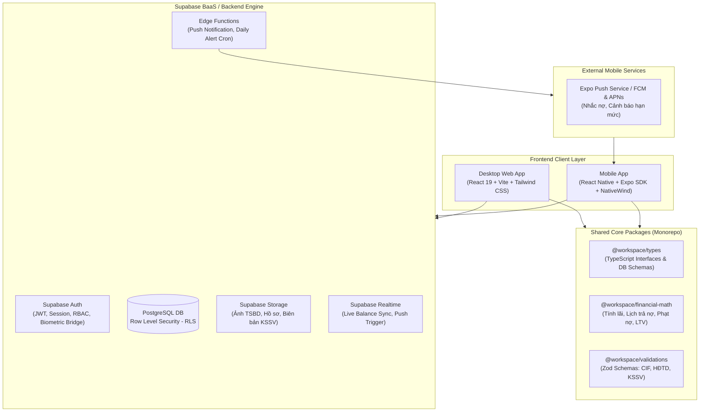
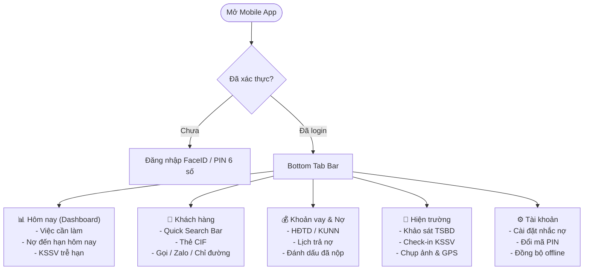
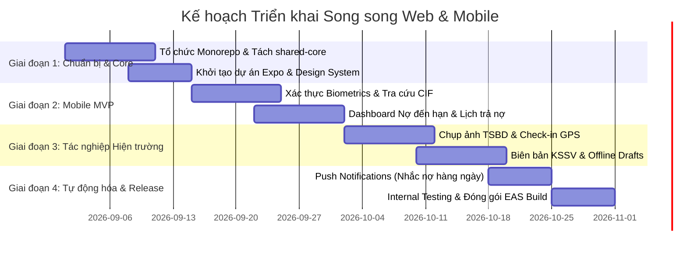

# CHIẾN LƯỢC VÀ KIẾN TRÚC PHÁT TRIỂN SONG SONG: WEB ADMIN & MOBILE APP (REACT NATIVE)

> **Tài liệu chiến lược kỹ thuật & sản phẩm (Product & Technical Blueprint)**  
> **Dự án**: Customer Manager (Hệ thống Quản lý Khách hàng, Hợp đồng Tín dụng, Tài sản Bảo đảm & Kiểm soát sau vay)  
> **Tác giả**: Solution Architect & Lead Product Manager  
> **Ngày lập**: 16/08/2026

---

## 1. TỔNG QUAN VÀ VẤN ĐỀ CỐT LÕI (PROBLEM STATEMENT)

### 1.1. Bối cảnh & Điểm nghẽn khi dùng Web trên Điện thoại
Hiện tại, phiên bản Web của hệ thống **Customer Manager** được tối ưu hóa cho màn hình Desktop:
- **Bảng dữ liệu phức tạp (Data Grid/Tables)**: Các bảng danh sách HĐTD, KUNN, Lịch trả nợ, Định giá TSBD có từ 10 - 25 cột dữ liệu. Khi hiển thị trên màn hình điện thoại (viewport 375px - 430px), giao diện bị vỡ, người dùng phải cuộn ngang liên tục (horizontal scroll fatigue).
- **Form nhập liệu nhiều bước**: Các nghiệp vụ cấp tín dụng, giải ngân, lập biên bản KSSV có form dài, nhiều trường số tiền, ngày tháng; bàn phím ảo (virtual keyboard) che khuất input, trải nghiệm gõ số và chọn ngày rất chậm và dễ sai sót.
- **Thiếu tương tác phần cứng**: Cán bộ tín dụng (CBTD/QHKH) đi thực địa hiện trường không thể tận dụng camera trực tiếp để chụp ảnh tài sản/hộ kinh doanh, không có thông báo đẩy (Push Notification) tức thời khi đến hạn trả nợ/đáo hạn, không gọi điện 1-chạm (Quick Dial/Zalo) trực tiếp cho khách hàng.
- **Rủi ro mạng chập chờn khi ra ngoài (No Offline Support)**: Web app phụ thuộc hoàn toàn vào kết nối mạng liên tục.

### 1.2. Mục tiêu mô hình Song Song (Dual-Platform Strategy)
Tách bạch rõ ràng vai trò và trải nghiệm giữa 2 nền tảng:
1. **Desktop Web (Back-Office & Operations Powerhouse)**: Dành cho công việc ngồi bàn giấy: đối soát chi tiết, xuất báo cáo PDF/Excel, quản trị hệ thống, phân tích số liệu tài chính chuyên sâu, cấu hình lãi suất và chính sách.
2. **Mobile App (Field-Work & Fast-Action Companion)**: Dành cho CBTD tác nghiệp di động: tra cứu nhanh CIF/dư nợ, nhận thông báo nhắc nợ/đáo hạn, chụp ảnh tài sản gắn GPS tại hiện trường, gọi điện/nhắn tin khách hàng 1 chạm, ghi nhận nhanh kết quả kiểm tra sau vay.

---

## 2. PHÂN HOẠCH VAI TRÒ TÍNH NĂNG (WEB VS. MOBILE APP)

| Nhóm nghiệp vụ | Desktop Web App (Quản trị & Phân tích) | Mobile App (Tác nghiệp & Hiện trường) |
| :--- | :--- | :--- |
| **Tra cứu Khách hàng (CIF)** | Bảng tổng hợp đầy đủ, lọc nâng cao theo 15+ tiêu chí, xuất danh sách Excel/CSV. | Tìm kiếm siêu tốc (Tên, SĐT, CCCD, CIF), thẻ tóm tắt (Summary Card), nút gọi/Zalo/chỉ đường 1-chạm. |
| **Hợp đồng & Khế ước (HĐTD / KUNN)** | Bảng chi tiết, phân bổ TSBD đa chiều, điều chỉnh biên độ lãi suất hàng loạt, lịch sử lãi suất. | Xem nhanh dư nợ hiện tại, hạn mức còn lại, danh sách khế ước đang active, xem nhanh lịch trả nợ kỳ tới. |
| **Lịch trả nợ & Thu nợ** | Bảng tính toán dòng tiền, khấu hao gốc/lãi, phân tích nợ quá hạn chi tiết toàn danh mục. | **Widget & Danh sách nhắc nợ hôm nay/tuần này**: Badge đánh dấu đã nộp tiền, cảnh báo nợ nhóm 2+. |
| **Tài sản bảo đảm (TSBD)** | Quản lý kho tài sản, định giá lại theo đợt, phân bổ tài sản cho nhiều HĐTD/thẻ. | **Chụp ảnh định giá tại chỗ**: Upload ảnh khảo sát trực tiếp từ camera, đính kèm GPS tọa độ, note nhanh hiện trạng. |
| **Kiểm soát sau vay (KSSV)** | Lập kế hoạch kiểm tra định kỳ, duyệt biên bản KSSV, báo cáo kiểm toán nội bộ. | **Checklist kiểm tra thực địa**: Điền kết quả (Pass/Watch/Fail), chụp ảnh hóa đơn/chứng từ/nhà xưởng, ký nhận điện tử. |
| **Sao kê & Phân tích GD** | Phân tích sao kê PDF/Excel nhiều trang, biểu đồ dòng tiền, phát hiện bất thường. | Xem tóm tắt dòng tiền vào/ra, cảnh báo số dư thấp/giao dịch lớn qua Push Notification. |
| **Bảo mật & Trải nghiệm** | Email/Password, OTP, phân quyền RBAC chi tiết từng module. | **FaceID / Vân tay (Biometrics)**, Quick PIN 6 số, Offline Drafts khi mất sóng. |

---

## 3. KIẾN TRÚC HỆ THỐNG TỔNG THỂ (SYSTEM ARCHITECTURE)



### 3.1. Các nguyên tắc kiến trúc cốt lõi (Guiding Principles)
1. **Single Source of Truth (Một nguồn chân lý dữ liệu duy nhất)**: Toàn bộ dữ liệu nằm tại PostgreSQL của Supabase. RLS (Row Level Security) kiểm soát quyền truy cập như nhau cho cả Web và Mobile.
2. **Zero Logic Duplication (Không trùng lặp công thức tài chính)**: Các thuật toán tính toán lãi suất, chia kỳ trả nợ, tính phạt quá hạn, kiểm tra tỷ lệ LTV được viết 1 lần bằng TypeScript và đóng gói dùng chung cho cả Web và Mobile App.
3. **Optimized API Payloads for Mobile**: Tránh truyền các payload JSON hàng megabytes về điện thoại. Sử dụng Database Views và Postgres Stored Procedures (RPC) riêng cho mobile để trả về dữ liệu tinh gọn (summary cards).

---

## 4. NGĂN XẾP CÔNG NGHỆ KHUYẾN NGHỊ CHO MOBILE APP

### 4.1. Mobile Tech Stack
- **Framework**: **React Native (v0.76+) với Expo SDK (Managed Workflow)**.
  - *Lý do*: Expo hiện tại là tiêu chuẩn vàng của React Native, hỗ trợ EAS Build (build iOS/Android trên cloud), OTA Updates (EAS Update để vá lỗi tức thì không cần đợi Apple/Google duyệt lại app), và hỗ trợ sẵn 100% native module cần thiết.
- **Styling**: **NativeWind v4** (Tailwind CSS cho React Native).
  - *Lý do*: Tái sử dụng 100% Design Token, mã màu, quy tắc khoảng cách (spacing scale) từ `index.css` và hệ thống màu của Web.
- **State Management & Caching**: **TanStack Query (React Query v5)** + **Zustand** (Local UI state).
  - *Lý do*: Cache dữ liệu khách hàng cực mạnh, tự động background fetch, hỗ trợ retry khi mạng yếu.
- **Local Storage / Offline Cache**: **`expo-sqlite`** hoặc **`react-native-mmkv`** (tốc độ đọc/ghi nhanh gấp 30 lần AsyncStorage thông thường).
- **Phần cứng & Thiết bị**:
  - `expo-camera` / `expo-image-picker`: Chụp và nén ảnh tài sản bảo đảm trước khi upload.
  - `expo-local-authentication`: Đăng nhập nhanh bằng FaceID / TouchID / Vân tay.
  - `expo-notifications`: Tiếp nhận Push Notification nhắc nợ tự động lúc 08:00 sáng.
  - `expo-location`: Đính kèm tọa độ GPS vào biên bản khảo sát hiện trường TSBD/KSSV.
  - `react-native-haptic-feedback`: Phản hồi rung tinh tế khi người dùng xác nhận thao tác tài chính.

---

## 5. MÔ HÌNH QUẢN LÝ MÃ NGUỒN (MONOREPO VS. POLYREPO)

### Khuyến nghị: Sử dụng **Turborepo (Monorepo)**

Cấu trúc thư mục định hướng:
```
CustomerManager/
├── apps/
│   ├── web/                     # Ứng dụng Web hiện tại (Vite + React 19)
│   │   ├── src/
│   │   ├── package.json
│   │   └── vite.config.ts
│   └── mobile/                  # Ứng dụng Mobile mới (Expo + React Native)
│       ├── app/                 # Expo Router (Tabs, Stacks, Modals)
│       │   ├── (tabs)/
│       │   │   ├── index.tsx    # Dashboard (Thống kê nhanh, Việc cần làm)
│       │   │   ├── customers/   # Danh bạ CIF & Chi tiết nhanh
│       │   │   ├── loans/       # Lịch trả nợ, Danh sách nợ đến hạn
│       │   │   └── field-work/  # Khảo sát TSBD & KSSV thực địa
│       │   ├── _layout.tsx
│       │   └── login.tsx        # Biometrics + Passcode
│       ├── package.json
│       └── app.json
├── packages/
│   ├── shared-types/            # Export toàn bộ interfaces (Customer, LoanContract, ...)
│   ├── shared-core/             # Logic tính toán tài chính, format tiền VND, validate CIF/CCCD
│   └── shared-supabase/         # Supabase client helpers, query keys
├── supabase/                    # Migrations, RLS policies, Edge functions, Seeds
├── package.json                 # Workspace root (pnpm hoặc npm workspaces)
└── turbo.json                   # Cấu hình pipeline build/lint/test
```

### Lợi ích của Monorepo:
1. Sửa schema database/type -> Cả Web và Mobile tự động báo lỗi TypeScript nếu không tương thích ngay tại thời điểm build.
2. Không bị tình trạng "Web hiển thị số tiền lãi một kiểu, Mobile tính ra một kiểu khác".
3. Dùng chung bộ helper format tiền tệ (ví dụ: `formatVND(1250000000)` -> `1.25 tỷ`), format ngày tháng chuẩn Việt Nam (`DD/MM/YYYY`).

---

## 6. THIẾT KẾ TRẢI NGHIỆM NGƯỜI DÙNG MOBILE (MOBILE UI/UX BLUEPRINT)

Áp dụng tiêu chuẩn **UI/UX Pro Max** & **Thumb-Zone Navigation**:

### 6.1. Kiến trúc màn hình Mobile (Navigation Architecture)


### 6.2. Thiết kế chi tiết cho các tác vụ then chốt (Key Mobile Flows)

#### A. Thẻ Khách hàng Tác nghiệp Nhanh (Quick Action CIF Card)
Thay vì hiển thị bảng 15 cột, Mobile hiển thị dạng Card bo tròn (`rounded-2xl`), phân cấp thị giác rõ ràng:
- **Header**: Tên khách hàng (Bold lớn) + Badge Xếp hạng tín dụng (AAA/AA/A) + Trạng thái CIC (Xanh/Vàng/Đỏ).
- **Body**: CIF, CCCD, Tổng dư nợ hiện tại (VND in đậm), Số lượng HĐTD/KUNN đang vay.
- **Action Bar (Quick Buttons)**:
  - 📞 **Gọi điện**: Mở trực tiếp ứng dụng điện thoại gọi cho khách hàng hoặc vợ/chồng.
  - 💬 **Zalo**: Mở Zalo chat với số điện thoại khách hàng.
  - 📍 **Địa chỉ**: Mở Google Maps điều hướng đến nhà riêng/địa chỉ TSBD.
  - 📋 **Hợp đồng**: Mở nhanh danh sách khế ước và dư nợ hiện tại.

#### B. Dashboard Nhắc nợ Hôm nay (Due Date Alert Center)
- **Top Metrics**: 3 con số quan trọng nhất đầu ngày:
  - *Tổng số tiền cần thu hôm nay*.
  - *Số lượng khách hàng đến hạn trả gốc/lãi*.
  - *Số lượng biên bản KSSV cần hoàn thành trong tuần*.
- **List tương tác**: Vuốt sang phải để "Đánh dấu đã nộp", vuốt sang trái để "Gọi nhắc nợ ngay".

#### C. Chụp ảnh & Lập biên bản Hiện trường (Field Survey Camera Flow)
- Mở Camera toàn màn hình có watermark tự động: Ngày giờ thực tế + Tọa độ GPS + Mã TSBD/CIF.
- Nén ảnh cục bộ trên thiết bị (giảm từ 10MB xuống ~600KB) trước khi upload lên Supabase Storage ngầm trong background (không chặn người dùng thao tác tiếp).
- Checklist KSSV dạng toggle 1-chạm (Mục đích vay: Đạt/Cảnh báo; Hiện trạng tài sản: Bình thường/Hao mòn; Tình hình kinh doanh: Tốt/Chậm).

---

## 7. CHIẾN LƯỢC TỐI ƯU CƠ SỞ DỮ LIỆU & API CHO MOBILE

### 7.1. Database Best Practices (Supabase & PostgreSQL)

#### Vấn đề:
Mobile app có băng thông mạng thấp hơn và CPU di động cần tiết kiệm pin. Không được gọi các câu truy vấn SELECT `*` với 4-5 tầng `JOIN` phức tạp trực tiếp từ điện thoại.

#### Giải pháp kỹ thuật:
1. **Tạo Materialized View / Optimized Views cho Mobile Dashboard**:
   ```sql
   -- View tóm tắt cho màn hình Dashboard Mobile
   CREATE OR REPLACE VIEW v_mobile_daily_due_summary AS
   SELECT 
       rs."Id" AS schedule_id,
       rs."ContractId" AS contract_id,
       rs."DueDate" AS due_date,
       rs."TotalAmount" AS total_amount,
       rs."PrincipalAmount" AS principal_amount,
       rs."InterestAmount" AS interest_amount,
       c."Id" AS customer_id,
       c."FullName" AS customer_name,
       c."Phone" AS customer_phone,
       c."CifKh" AS cif_kh,
       lc."ContractNumber" AS contract_number
   FROM "RepaymentSchedule" rs
   JOIN "LoanContract" lc ON rs."ContractId" = lc."Id"
   JOIN "Customer" c ON lc."CustomerId" = c."Id"
   WHERE rs."IsPaid" = FALSE 
     AND rs."DueDate" <= (CURRENT_DATE + INTERVAL '7 days');
   ```

2. **Index Tối ưu cho Mobile Query (Postgres Indexing)**:
   ```sql
   -- Tăng tốc tìm kiếm nhanh CIF/Phone/CCCD trên thanh search mobile (< 10ms)
   CREATE INDEX IF NOT EXISTS idx_customer_mobile_search 
   ON "Customer" ("Phone", "NationalId", "CifKh");

   -- Tăng tốc lọc lịch trả nợ đến hạn theo ngày
   CREATE INDEX IF NOT EXISTS idx_repayment_schedule_due_paid 
   ON "RepaymentSchedule" ("DueDate", "IsPaid") 
   WHERE "IsPaid" = FALSE;
   ```

3. **Supabase Edge Function cho Push Notifications tự động**:
   - Thiết lập cron job chạy mỗi sáng lúc 07:30.
   - Quét các hợp đồng có hạn thanh toán trong ngày hoặc quá hạn.
   - Gửi Push Notification qua Expo Notification Service tới thiết bị của CBTD quản lý.

---

## 8. LỘ TRÌNH TRIỂN KHAI THEO GIAI ĐOẠN (ROADMAP & MILESTONES)



### Chi tiết các giai đoạn:

#### 🔹 Giai đoạn 1: Khởi tạo Monorepo & Bộ lõi dùng chung (1-2 tuần)
- Chuyển source code sang cấu trúc Turborepo (`apps/web`, `apps/mobile`, `packages/shared-core`).
- Đưa các hàm tính toán lịch trả nợ, format tiền tệ, validation Zod vào `packages/shared-core`.
- Cấu hình Expo SDK 52+ với NativeWind v4 để đồng bộ bảng màu và design token.

#### 🔹 Giai đoạn 2: Mobile MVP - Tra cứu & Quản lý Nợ (2 tuần)
- Đăng nhập an toàn: Supabase Auth kết hợp FaceID / Vân tay / PIN 6 số.
- Màn hình Tra cứu Khách hàng siêu tốc (tìm theo tên, CIF, SĐT, CCCD).
- Chi tiết khách hàng rút gọn + Action 1-chạm (Gọi điện, Nhắn tin Zalo).
- Danh sách nợ đến hạn trong ngày/trong tuần + Đánh dấu đã thanh toán.

#### 🔹 Giai đoạn 3: Tác nghiệp Thực địa (Field Operations) (2 tuần)
- Tính năng khảo sát TSBD: Chụp ảnh hiện trường, đóng dấu GPS + ngày giờ, upload ảnh nén lên Supabase Storage.
- Lập biên bản Kiểm soát sau vay (KSSV) nhanh dạng checklist trên điện thoại.
- Cơ chế lưu nháp ngoại tuyến (Offline drafts) khi không có sóng 4G.

#### 🔹 Giai đoạn 4: Thông báo đẩy & Phát hành nội bộ (1-2 tuần)
- Cấu hình Expo Push Notification cho sự kiện: Nợ đến hạn, TSBD sắp hết hạn định giá, HĐTD sắp hết hạn mức.
- Build file cài đặt nội bộ (file `.apk` cho Android và TestFlight cho iOS) thông qua EAS Build.

---

## 9. ĐÁNH GIÁ RỦI RO VÀ GIẢI PHÁP PHÒNG NGỪA

| Rủi ro tiềm ẩn | Mức độ | Giải pháp phòng ngừa |
| :--- | :---: | :--- |
| **Lệch công thức tính toán giữa Web và App** | Cao | Bắt buộc 100% logic tính lãi, phạt, ngày đến hạn phải import từ `packages/shared-core` có Unit Test bao phủ bằng Vitest. |
| **Mất kết nối mạng khi đi khảo sát vùng sâu** | Trung bình | Tích hợp SQLite/MMKV lưu tạm biên bản khảo sát và ảnh vào bộ nhớ máy; tự động đẩy lên server khi có mạng trở lại (Auto-sync on reconnect). |
| **Dung lượng ảnh tải lên quá lớn làm đầy Storage** | Trung bình | Nén ảnh trực tiếp trên client (Mobile Image Manipulator) xuống chuẩn 1280x720 JPEG (chất lượng 70%) trước khi upload. |
| **Bảo mật dữ liệu nhạy cảm khi mất điện thoại** | Cao | Khóa app tự động sau 2 phút không hoạt động; bắt buộc xác thực lại bằng FaceID/PIN; không lưu thông tin mật khẩu hay token dài hạn dạng plain text. |

---

## 10. KẾT LUẬN & HÀNH ĐỘNG TIẾP THEO

Mô hình **Web Admin (Desktop) + Mobile App Tác nghiệp (React Native/Expo)** là lời giải tối ưu cho hệ thống quản lý tín dụng & khách hàng. Thay vì cố ép giao diện web phức tạp vào màn hình điện thoại bé nhỏ, việc phát triển ứng dụng di động chuyên dụng sẽ:
1. **Tăng 300% tốc độ tra cứu và xử lý công việc ngoài hiện trường** của cán bộ tín dụng.
2. **Loại bỏ hoàn toàn cảm giác khó chịu/lag/vỡ layout** khi thao tác trên điện thoại.
3. **Khai thác tối đa phần cứng di động**: FaceID, Camera khảo sát, GPS, Cuộc gọi 1-chạm và Thông báo đẩy chủ động.

*(Kế hoạch đã sẵn sàng để kích hoạt bất kỳ lúc nào theo quyết định của bạn).*
