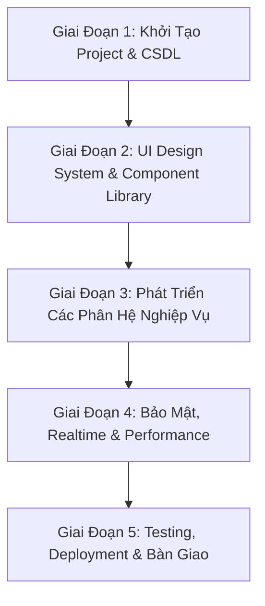

# 🌐 KẾ HOẠCH BÀI BẢN CHUYỂN ĐỔI HỆ THỐNG QUẢN LÝ TÍN DỤNG SANG WEB APPLICATION

---

## 1. 📌 TỔNG QUAN HỆ THỐNG & MỤC TIÊU CHUYỂN ĐỔI

- **Hệ thống hiện tại:** WPF Desktop App (.NET 10.0) kết nối CSDL Supabase PostgreSQL Cloud.
- **Mục tiêu Web App:** Đa nền tảng (Responsive Web App), giao diện Dark/Light Mode Enterprise chuẩn mực, truy cập mượt mà trên Desktop, Laptop (Windows / Mac), iPad, Tablet và Điện thoại thông minh mà không cần cài đặt.
- **Kiến trúc Công nghệ Đề xuất:**
  - **Frontend Framework:** React / Next.js hoặc Vite + TypeScript + TailwindCSS / Custom CSS Design System.
  - **Icon & UI Components:** Lucide Icons, Headless UI / Radix UI, Recharts (Đồ thị tín dụng & dư nợ).
  - **Database & Backend Layer:** Kết nối trực tiếp Supabase Cloud PostgreSQL via Supabase Client SDK (`@supabase/supabase-js`) + Realtime Subscriptions + Row Level Security (RLS).

---

## 2. 🗂️ BẢNG CÁC CÔNG VIỆC CHUYỂN ĐỔI CHI TIẾT (WORK BREAKDOWN STRUCTURE - WBS)

---

### 🔹 GIAI ĐOẠN 1: KHỞI TẠO NỀN TẢNG CÔNG NGHỆ & CƠ SỞ DỮ LIỆU (DATABASE & PROJECT SETUP)

| STT | Công việc | Chi tiết kỹ thuật | Kết quả đầu ra |
| :---: | :--- | :--- | :--- |
| **1.1** | **Khởi tạo Dự án Web** | Initialize Next.js / Vite + TypeScript + TailwindCSS | Dự án Web cơ bản chạy thành công |
| **1.2** | **Cấu hình Supabase SDK** | Tích hợp `@supabase/supabase-js`, cài đặt API Key & Supabase Client Context | Kết nối CSDL Supabase PostgreSQL sẵn sàng |
| **1.3** | **Bảo tồn CSDL PostgreSQL** | Giữ nguyên 100% Schema hiện tại (`Customers`, `LoanContracts`, `Loans`, `Collaterals`, `LoanCollaterals`, `CreditCards`, `ApprovalConditions`, `PostLoanControls`, `LoanSchedules`) | CSDL Cloud đồng bộ hoàn toàn |

---

### 🔹 GIAI ĐOẠN 2: THIẾT KẾ THƯ VIỆN GIAO DIỆN CHUẨN ENTERPRISE (UI DESIGN SYSTEM)

| STT | Công việc | Chi tiết kỹ thuật | Kết quả đầu ra |
| :---: | :--- | :--- | :--- |
| **2.1** | **Xây dựng Theme & Token** | Cấu hình Bảng màu Enterprise (Dark Mode #0F172A, Primary #0284C7, HSL tailor), Font chữ Inter/Outfit | Design System nhất quán |
| **2.2** | **Khung Điều Hướng Sidebar** | Sidebar Tab: Khách hàng, Khoản vay, Tài sản, Thẻ tín dụng, Kiểm soát sau vay | Navigation Bar trơn tru |
| **2.3** | **Header & Global Bar** | Thanh tìm kiếm đa năng, Badges trạng thái kết nối Database, Nút đổi giao diện | Header chuẩn Ngân hàng |
| **2.4** | **Re-usable UI Components** | DataGrid / Table (Dán tràn 100% chiều cao, Phân trang, Format VNĐ), Input, Select, Modal Dialog, Badges | Bộ Component dùng chung |

---

### 🔹 GIAI ĐOẠN 3: PHÁT TRIỂN CÁC PHÂN HỆ NGHIỆP VỤ CHÍNH (MODULE DEVELOPMENT)

#### 3.1. Phân Hệ Quản Lý Khách Hàng & Khách Hàng Liên Quan (KHLQ)
- [ ] **Thanh tra cứu 3 tiêu chí:** Lọc real-time theo Mã CIF, Họ tên KH, Số CCCD.
- [ ] **Form Khai báo Hồ sơ Pháp lý & Hôn nhân:** Ô nhập Mã CIF KHLQ, Họ tên Vợ/Chồng, STK KH, STK Vợ/Chồng.
- [ ] **Modal Xem Chi Tiết:** Cửa sổ Popup xem toàn bộ pháp lý KH và KHLQ.
- [ ] **Tính năng Import / Export:** Tải lên tệp CSV/JSON và xuất danh sách KH ra CSV.

#### 3.2. Phân Hệ Quản Lý Hợp Đồng Tín Dụng & Giấy Nhận Nợ (KUNN)
- [ ] **Thanh tra cứu HĐTD đa năng:** Tra cứu theo Mã CIF, Họ tên KH, Số HĐTD / STK Vay.
- [ ] **Phân loại Hợp đồng:** Bộ lọc Hạn Mức Tín Dụng (HMTD) và Cho Vay Từng Lần (Term Loan).
- [ ] **Thu nợ kỳ & Tự động nhảy Lịch trả nợ:** Xử lý ngày giải ngân vs ngày trả nợ đầu tiên (15/tháng), gốc giảm dần và LTV vay giảm tương ứng.
- [ ] **Cảnh báo Hạn KUNN & Hạn HĐTD:** Badge tô màu cảnh báo theo mức độ rủi ro (Xanh, Vàng, Đỏ).

#### 3.3. Phân Hệ Quản Lý & Định Giá Tài Sản Bảo Đảm (TSĐB)
- [ ] **Thanh tra cứu TSĐB đa năng:** Lọc theo Mã CIF KH, Tên KH Chủ sở hữu, Mã TS chứng thư.
- [ ] **Phân loại Xếp loại Tài sản:** Loại 1 (LTV 80%), Loại 2 (LTV 70%), Loại 3 (LTV 60%), Loại 4 (LTV 55%), Hạn chế (LTV 0%).
- [ ] **Theo dõi Hạn Định giá TSĐB:** Tự động tính số ngày còn lại của chứng thư định giá.
- [ ] **Gán TSĐB cho Hợp đồng:** Liên kết 1 hoặc nhiều HĐTD với TSĐB.

#### 3.4. Phân Hệ Thẻ Tín Dụng & Điều Kiện Phê Duyệt / Kiểm Soát Sau Vay
- [ ] **Phân loại diện mở thẻ:** Cầm cố STK, Quan hệ tín dụng (liên kết TSĐB), Tín chấp theo lương/CBNV.
- [ ] **Quản lý CASA & Dòng tiền:** Quản lý đợt kiểm soát sau vay gần nhất và đợt tiếp theo.

---

### 🔹 GIAI ĐOẠN 4: BẢO MẬT, ĐỒNG BỘ REALTIME & TỐI ƯU HIỆU NĂNG

| STT | Công việc | Chi tiết kỹ thuật | Kết quả đầu ra |
| :---: | :--- | :--- | :--- |
| **4.1** | **Xác thực & Phân quyền** | Tích hợp Supabase Auth (Đăng nhập Email/Pass/Google), Phân quyền Row Level Security (RLS) | Hệ thống bảo mật chuẩn |
| **4.2** | **Đồng bộ Realtime** | Sử dụng Supabase Realtime Subscriptions (khi Banker A nhập dữ liệu, Banker B thấy ngay mà không cần F5) | Trải nghiệm Realtime mượt mà |
| **4.3** | **Tối ưu Performance** | Cấu hình React Query / SWR Caching, Lazy-loading Modal & Component nặng | Tốc độ tải dưới 1 giây |

---

### 🔹 GIAI ĐOẠN 5: KIỂM THỬ, TRIỂN KHAI (DEPLOYMENT) & BÀN GIAO

| STT | Công việc | Chi tiết kỹ thuật | Kết quả đầu ra |
| :---: | :--- | :--- | :--- |
| **5.1** | **Kiểm thử Nghiệp vụ** | Verify công thức LTV, Lịch thu nợ, Bóc tách tên KH có dấu `-`, Import/Export CSV | 0 Lỗi nghiệp vụ |
| **5.2** | **Deploy Production** | Deploy Web App lên Vercel / Netlify / Docker Server nội bộ, Cấu hình SSL HTTPS | Website chạy trực tuyến 24/7 |
| **5.3** | **Cấu hình Domain** | Trỏ Tên miền tùy chỉnh (ví dụ: `tindung.yourbank.com`) | Đường dẫn chuyên nghiệp |
| **5.4** | **Nghiệm thu & Bàn giao** | Viết tài liệu Hướng dẫn sử dụng & Bàn giao mã nguồn | Hoàn thành 100% dự án |

---

> [!TIP]
> **Kế hoạch này đảm bảo khi chuyển sang Web App, hệ thống giữ được 100% tính chính xác về nghiệp vụ Ngân hàng của ứng dụng hiện tại, đồng thời nâng tầm giao diện đẹp mắt, linh hoạt và tiện dụng hơn gấp nhiều lần!**
